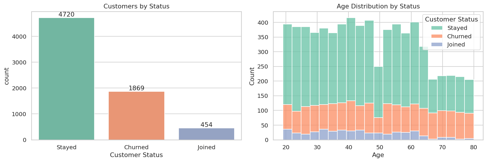
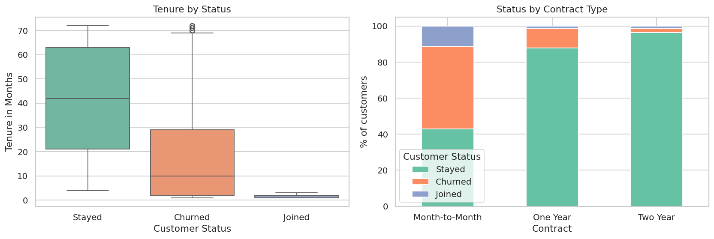
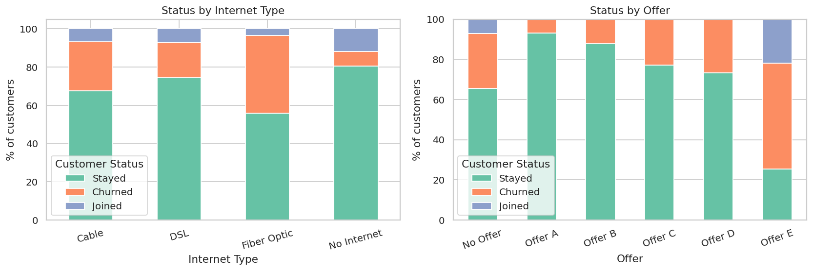
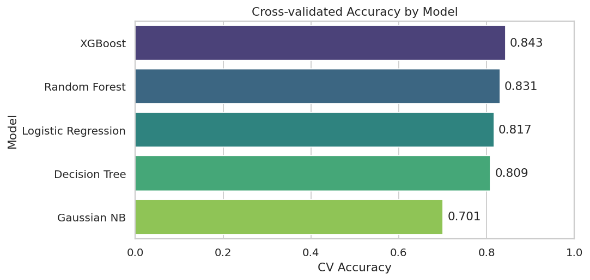
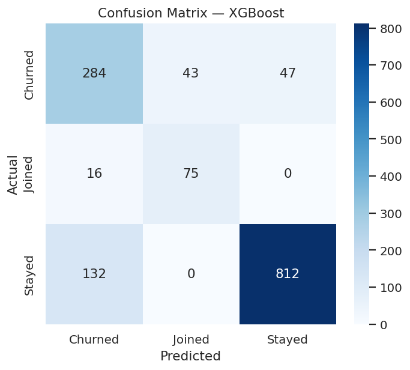
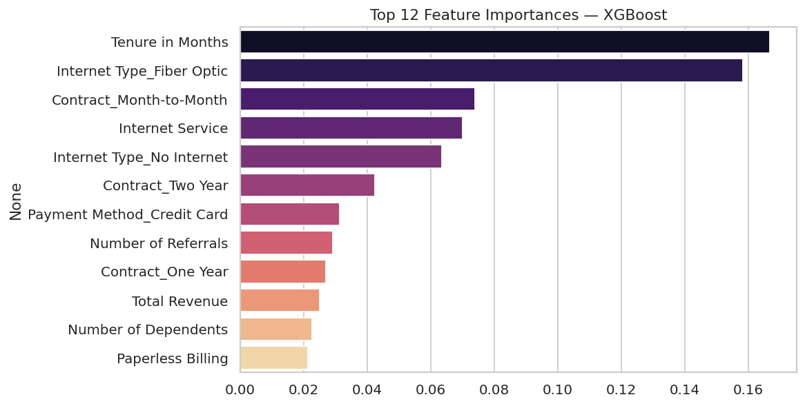

# 📉 Telecom Customer Retention ML

Predicting whether a telecom customer will **churn**, **stay**, or **join** — using Python, scikit-learn and XGBoost.

## Problem Statement
The dataset contains **7,043 customers** of a California telecom company (Q2 2022). Each row is one customer with demographics, location, tenure, subscribed services, billing details and the **status for the quarter** (Joined / Stayed / Churned).

**Goal:** build a multi-class classifier for `Customer Status` so the company can spot customers at risk of leaving and target retention offers.

## Dataset
| File | Description |
|---|---|
| `Datasets/telecom_customer_churn.csv` | 7,043 customers × 38 columns (demographics, services, charges, status) |

Class split: **Stayed 4,720 · Churned 1,869 · Joined 454** (imbalanced).

## Project Structure
```
Telecom-Customer-Retention-ML/
├── Datasets/
│   └── telecom_customer_churn.csv
├── src/
│   └── Customer_Churn_Prediction.ipynb
├── assets/                # charts used in this README
├── requirements.txt
├── .gitignore
└── README.md
```

## Approach
1. **Cleaning** – missing values were *structural* (e.g. no internet → blank streaming columns), so they were filled with meaningful values instead of dropping rows. **All 7,043 rows are kept.** Target-leaking columns (`Churn Category`, `Churn Reason`), IDs and geo columns were removed.
2. **EDA** – status distribution, tenure, contract type, internet type, offers, correlations.
3. **Encoding** – binary mapping, one-hot encoding (Contract, Internet Type, Payment Method, Offer), label-encoded target.
4. **Split & scaling** – stratified 80/20 split; MinMax scaler **fit on train only** (no data leakage).
5. **Modelling** – 5 models compared with 5-fold stratified cross-validation; XGBoost trained with and without class weights.
6. **Evaluation** – accuracy, macro-F1, per-class report, confusion matrix, feature importance.

## Results
**Cross-validation (training set)**

| Model | CV Accuracy | CV Macro-F1 |
|---|---|---|
| **XGBoost** | **0.843** | **0.760** |
| Random Forest | 0.831 | 0.736 |
| Logistic Regression | 0.817 | 0.709 |
| Decision Tree | 0.809 | 0.707 |
| Gaussian NB | 0.701 | 0.595 |

**Test set (1,409 customers)**

| Model | Accuracy | Macro-F1 |
|---|---|---|
| XGBoost (plain) | **85.2%** | 0.771 |
| XGBoost (balanced class weights) — *final* | 83.1% | **0.774** |

The class-weighted model trades a little accuracy for much better recall on the small *Joined* class (**0.82**), so it is used as the final model.

| Class | Precision | Recall | F1 |
|---|---|---|---|
| Churned | 0.66 | 0.76 | 0.71 |
| Joined | 0.64 | 0.82 | 0.72 |
| Stayed | 0.95 | 0.86 | 0.90 |

### Charts







## Key Insights
- **Month-to-month** customers churn far more than one- or two-year contract customers.
- **Short tenure** and **fiber-optic internet** are the strongest churn signals.
- Top model features: tenure, fiber optic, month-to-month contract, number of referrals, payment method.
- **Business action:** push contract upgrades and retention offers to new, month-to-month fiber customers.

## How to Run
```bash
git clone https://github.com/<waishhh>/Telecom-Customer-Retention-ML.git
cd Telecom-Customer-Retention-ML
pip install -r requirements.txt
jupyter notebook src/Customer_Churn_Prediction.ipynb
```

## Tech Stack
Python · pandas · NumPy · scikit-learn · XGBoost · Matplotlib · Seaborn

## Future Improvements
- Hyperparameter tuning (Optuna / GridSearch)
- SHAP explainability
- Probability calibration
- Streamlit app for live predictions

## Author
**Vaishnav** — B.Tech CSE (AI), Amrita Vishwa Vidyapeetham
[LinkedIn]( https://www.linkedin.com/in/vaishnav-pv/) · [GitHub]( https://github.com/vaishnavwaishuu)

